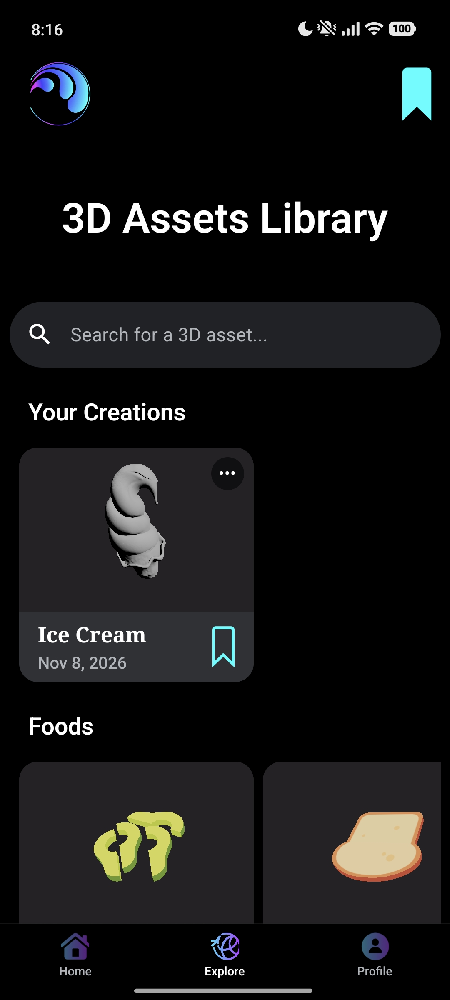
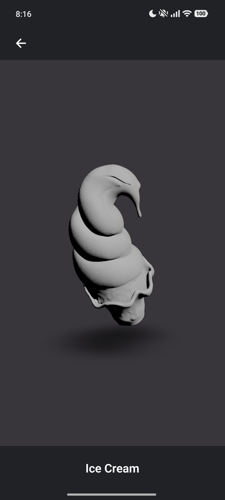

<!-- Badges -->

[](https://sonarcloud.io/summary/new_code?id=spotnack_meta-ai-hackathon)

[](https://huggingface.co/spotnack/triposg-sm8750-qnn)

<!-- Sonar Badges -->

[](https://sonarcloud.io/summary/new_code?id=spotnack_meta-ai-hackathon)

[](https://sonarcloud.io/summary/new_code?id=spotnack_meta-ai-hackathon)
[](https://sonarcloud.io/summary/new_code?id=spotnack_meta-ai-hackathon)
[](https://sonarcloud.io/summary/new_code?id=spotnack_meta-ai-hackathon)

[](https://sonarcloud.io/summary/new_code?id=spotnack_meta-ai-hackathon)
[](https://sonarcloud.io/summary/new_code?id=spotnack_meta-ai-hackathon)
[](https://sonarcloud.io/summary/new_code?id=spotnack_meta-ai-hackathon)
[](https://sonarcloud.io/summary/new_code?id=spotnack_meta-ai-hackathon)
[](https://sonarcloud.io/summary/new_code?id=spotnack_meta-ai-hackathon)

[-v26.13.0-informational>)](https://nodejs.org/en)
[](https://yarnpkg.com/)
[](https://reactnative.dev/)
[-58.0.22-informational>)](https://docs.expo.dev/)
[-58.1.18-informational>)](https://docs.expo.dev/)

[](https://www.python.org/downloads/)
[](https://pytorch.org/)

[](https://github.com/spotnack/meta-ai-hackathon/graphs/commit-activity)

<!-- Dependencies -->

<a href="https://www.python.org/" target="_blank" rel="noopener noreferrer"></a>
<a href="https://developer.mozilla.org/en-US/docs/Web/JavaScript" target="_blank" rel="noopener noreferrer"></a>
&nbsp;
&nbsp;
<a href="https://react.dev/" target="_blank" rel="noopener noreferrer"></a>
&nbsp;
&nbsp;
<a href="https://threejs.org/" target="_blank" rel="noopener noreferrer"></a>
&nbsp;
&nbsp;
<a href="https://nodejs.org/en" target="_blank" rel="noopener noreferrer"></a>
&nbsp;
&nbsp;
<a href="https://pytorch.org/" target="_blank" rel="noopener noreferrer"></a>
&nbsp;
&nbsp;
<a href="https://aws.amazon.com/" target="_blank" rel="noopener noreferrer"></a>
<br>
<br>

<!-- Logo: -->
<div align="center">
  <a href="https://www.instagram.com/spotnack/#">
    
  </a>
</div>

<!-- Title: -->
<div align='center'>
  <h1> Meta Global AI Developer Hackathon </h1>
  <h2> On-Device AI Inference Pipeline for Image-to-3D Rectified-Flow Transformers </h2>
</div>

<!-- Demo: -->
<div align='center'>
  <h2><a href="https://youtube.com/shorts/laTVx9NDBKc?feature=share"> Watch the Demo Video </a></h2>
  <h2><a href="https://expo.dev/accounts/camponogaralucas/projects/client/builds/e586a265-e693-44bf-8585-073268ed151f"> Try the Preview Build on Your own Device (AI Model Available) </a></h2>
</div>

# Table of Contents

- [About](#about)
- [Motivation](#motivation)
- [Updates](#updates)
- [To Do](#todo)
- [Mobile App Architecture](#mobile-app-architecture)
- [On-Device AI Inference Pipeline](#pipeline)
- [Benchmarks](#benchmarks)
- [Install Dependencies](#dependencies)
- [Run the Mobile App](#run)
- [Reproduce From Scratch](#reproduce)
- [Contribution Guidelines](#contribution)
- [References](#references)

---

# About

sitory presents a mobile application with an on-device AI inference pipeline for 3D shape synthesis using an image-to-3D [Rectified-Flow Transformer](https://arxiv.org/pdf/2403.03206) model optimized to run in mobile applications.

The solution for the AI pipeline was developed during the [Meta Global AI Developer Hackathon](https://cerebralvalley.ai/e/meta-ai-developer-hackathon) using [Muse AI](https://dev.meta.ai/docs/muse-code).

- First commit (init): No AI inference (baseline application).
- Second commit: Begins to use Meta's Muse AI.

<p align="center">
  
  
</p>

<p align="center">
  
  
</p>

<p align="center">
  
  
</p>

<p align="center">
  
  
</p>

<p align="center">
  
  
</p>

<p align="center">
  
  
</p>

---

<!-- #region Motivation -->
<details>
  <summary><h1 id="motivation">Motivation</h1></summary>

The open-source image-to-3D [TripoSG](https://github.com/VAST-AI-Research/TripoSG) model is a 1.5B parameter rectified flow transformer trained on 2 million curated 3D shapes from open-source datasets including ShapeNet and Objaverse, as described in the [TripoSG paper](https://arxiv.org/abs/2502.06608).

During training, ground-truth 3D shape representations are encoded into 2048 latent tokens using a Variational Autoencoder (VAE). During inference, the trained model generates shape latents conditioned on an input image, and the VAE decoder reconstructs the 3D mesh from these latents. The paper also describes scaling the architecture to approximately 4B parameters using a Mixture-of-Experts (MoE) configuration and training at a latent resolution of 4096 tokens.

However, the GitHub repository recommends a CUDA-enabled GPU with at least `8GB of VRAM` for inference, adding a barrier for users who would like to experiment with large AI models on-device.

</details>
<!-- #endregion -->

---

<!-- #region Updates -->
<details>
  <summary><h1 id="updates">Updates</h1></summary>

Status of the [AI Pipeline Plan](docs/ai_pipeline_plan.md). Full details, sources and logs are in [docs/ai_pipeline_logs.md](docs/ai_pipeline_logs.md).

| Pipeline stage                                    | Status                                                     |
| ------------------------------------------------- | ---------------------------------------------------------- |
| Feasibility audit (Phase 0)                       | Done.                                                      |
| Golden reference set and parity harness (Phase 1) | Done: 5 images, thresholds fixed, all baselines pass.      |
| DINOv2 image encoder on the phone                 | Done: runs and matches the GPU output.                     |
| Rectified-flow transformer (1.5B) on the phone    | Done (Phase 2): runs on the NPU, ≈5 s per guided step.     |
| VAE decoder and mesh extraction on the phone      | Done (Phase 2): NPU decoder + C++ extraction.              |
| In-app on-device inference                        | Done (Phase 3): photo to mesh in the app, ≈3 min.          |
| NPU memory footprint                              | Done (Phase 3): one merged NPU session, no app kills.      |
| App polish, benchmarks, docs (Phase 4)            | Done: 176 s conversions, 0 app kills, parity 5/5, diagram. |

</details>
<!-- #endregion -->

---

<!-- #region To Do -->
<details>
  <summary><h1 id="todo">To Do</h1></summary>

- **Post-hackathon ideas:** better background removal (BiRefNet, MIT), 8-bit NPU weights if the runlist/scratch trade-off improves.

- **Add color to the 3D models:** TripoSG generates shape only, so meshes are gray.

- **Add support for:** iOS (QNN is Android-only) and non-Snapdragon Android phones.

- **Add support for other Snapdragon chips:** the AI model is compiled for the Snapdragon 8 Elite (SM8750, Hexagon V79) only. To support another chip, the following three steps are needed:
  1. Compile the model for the target chip by running `aihub_compile.py --device "<an AI Hub phone with your chip>"` (see [Reproduce From Scratch](docs/reproduce_from_scratch.md), step 5).
  2. Keep the target chip's NPU library in the APK: remove its `libQnnHtpV<NN>Skel.so` / `Stub.so` lines from the exclude list in `modules/triposg/app.plugin.js`.
  3. Allow the target chip in the app's support check (`preflight()` in `TripoSGModule.kt`, which currently accepts only `SM8750`).

</details>
<!-- #endregion -->

---

<!-- #region Mobile App Architecture -->
<details>
  <summary><h1 id="mobile-app-architecture">Mobile App Architecture</h1></summary>

This project focuses only on the AI inference feature of the Spotnack mobile application. The project is a Yarn 4 (Berry) monorepo located at `src/spotnack-muse/`, with two workspaces:

- `client/`: React Native app built with Expo.
- `server/`: Express.js REST API.

The root `package.json` holds the shared tooling (ESLint, Prettier, Jest, TypeScript, Babel) and the scripts that run both workspaces together, such as `yarn client`, `yarn server`, `yarn dev`, `yarn prod`, `yarn lint`, and `yarn test`. Node and Yarn versions are pinned via `engines` and `packageManager`.

The Frontend and Backend architectures, including the project's file source tree, are described in more detail at [docs/architecture.md](docs/architecture.md).

- The frontend follows the best practices outlined in [this open-source course](https://github.com/camponogaraviera/react-native) and uses the [MVVM architectural pattern](https://github.com/camponogaraviera/full-stack-ai-sw-roadmap/blob/main/full_stack/architectural_patterns/mvvm.md) and [Hexagonal architecture](https://github.com/camponogaraviera/full-stack-ai-sw-roadmap/blob/main/full_stack/architectural_patterns/hexagonal.md) (a.k.a. Ports and Adapters).
- The backend is a RESTful API built with `Express.js` and AWS SDK for authentication with [Amazon Cognito](https://github.com/camponogaraviera/aws/blob/main/infrastructure/security_identity/cognito.md).

</details>
<!-- #endregion -->

---

<!-- #region AI Pipeline -->
<details>
  <summary><h1 id="pipeline">On-Device AI Inference Pipeline</h1></summary>

The original TripoSG AI model architecture:

<p align="center">
  
</p>

The proposed on-device AI inference pipeline:

<p align="center">
  
</p>

- Per-block ONNX Export: the PyTorch model is exported to ONNX one block at a time (23 transformer parts, 2 VAE parts), so each export fits in a laptop with 16GB RAM.
- AI Hub Compile: Qualcomm AI Hub compiles each ONNX part, in the cloud, into a QNN context binary that runs on the Snapdragon 8 Elite's NPU.
- Merge Chain: the 23 compiled transformer parts are joined into one model, so the NPU shares one scratch buffer and locks 7.1 GB instead of 9.0 GB.
- Model Manifest: a list of every model file with its size and SHA-256 hash, which the app uses to check the files on the phone.
- Model Download: the app downloads the 6.9 GB model set from Hugging Face ([spotnack/triposg-sm8750-qnn](https://huggingface.co/spotnack/triposg-sm8750-qnn)) and checks every file against the manifest. Developers can also copy it over USB (`adb`).

Full details, sources, and logs can be found at [docs/ai_pipeline_logs.md](docs/ai_pipeline_logs.md). To rebuild the optimized AI model from scratch, see the [Reproduce From Scratch](#reproduce) section with a step-by-step guide including hardware requirements.

</details>
<!-- #endregion -->

---

<!-- #region AI Pipeline -->
<details>
  <summary><h1 id="benchmarks">Benchmarks</h1></summary>

Final results, measured on a Xiaomi 15 Ultra with the release build of the app. Full measurements are in [docs/ai_pipeline_logs.md](docs/ai_pipeline_logs.md).

| Metric                                   | Result                                                                                                                                                                                                                                                                 |
| ---------------------------------------- | ---------------------------------------------------------------------------------------------------------------------------------------------------------------------------------------------------------------------------------------------------------------------- |
| Photo to 3D model in the app             | ≈176 s, or 185 s in airplane mode (fully offline).                                                                                                                                                                                                                     |
| Time per stage                           | In the first test-image run (177.7 s in total): preparing the image 0.2 s, encoding the photo 3.0 s, loading models onto the NPU 11.3 s, generating the shape (50 steps) 150.2 s, VAE latent pass 0.3 s, building the mesh 11.2 s, simplifying the display mesh 1.5 s. |
| One transformer run on the NPU           | 1.5-1.7 s (each of the 50 steps runs it twice: with and without the image).                                                                                                                                                                                            |
| NPU memory locked during a conversion    | 7.1 GB of the phone's RAM.                                                                                                                                                                                                                                             |
| Lowest free RAM during a conversion      | ≈2.0 GB (≈2.6 GB while generating the shape).                                                                                                                                                                                                                          |
| Other apps closed by Android             | 0 (Spotify and YouTube Music kept playing).                                                                                                                                                                                                                            |
| Effect of merging the 23 model parts     | None on the output: the mesh is bit-for-bit identical.                                                                                                                                                                                                                 |
| Quality vs the cloud GPU (5 test images) | All 5 pass the mesh-match thresholds, for the full and the simplified mesh.                                                                                                                                                                                            |
| Time for the 5 test images               | 177-233 s each, run back to back. The phone slowed down as it heated up (generating the shape went from 150 s to 189 s).                                                                                                                                               |
| High-detail option                       | 75 s longer, and saves a 200k-triangle mesh instead of 100k.                                                                                                                                                                                                           |
| Cut-out preview (what the model sees)    | Ready in 1.0 s. It warned "cut off" on a cropped two-person selfie and gave no warning on a clean figurine photo.                                                                                                                                                      |
| Stopping a conversion                    | Stops 1.5-2.8 s after tapping Stop and leaves no files behind.                                                                                                                                                                                                         |
| Switching app tabs during a conversion   | Under 1 s.                                                                                                                                                                                                                                                             |
| Scrolling Explore during a conversion    | Smooth: 0 stuttering frames, 99% of frames drawn in 7 ms or less.                                                                                                                                                                                                      |
| Storage cleanup                          | Temporary files are deleted after each save, and old leftovers when the app starts (they had reached 278 MB).                                                                                                                                                          |
| App size (APK)                           | 63 MB, down from 98 MB.                                                                                                                                                                                                                                                |

Model size before and after the conversion. The photo is encoded by DINOv2. The phone needs only the VAE decoder, since the VAE encoder (which turns 3D meshes into latents) is used only for training.

| Part                     | What it does                                                                                                       | Parameters                                | Original weights (FP32, laptop) | On the phone                                                                                          |
| ------------------------ | ------------------------------------------------------------------------------------------------------------------ | ----------------------------------------- | ------------------------------- | ----------------------------------------------------------------------------------------------------- |
| Transformer              | Generates the 3D shape's 2048 latent tokens from noise in 50 steps, guided by the photo.                           | 1.44 billion                              | 5.4 GB                          | 5.2 GB, split into 23 parts, exported to ONNX and compiled for the NPU, FP32.                         |
| VAE                      | Decoder: turns the latent tokens into the 3D surface. Encoder: turns 3D meshes into latent tokens (training only). | 243 million (decoder 214 M, encoder 28 M) | 0.9 GB                          | 0.4 GB, decoder only (2 parts), exported to ONNX and compiled for the NPU, weights stored at 16 bits. |
| DINOv2 image encoder     | Vision Transformer (ViT-Large, 24 layers, by Meta) that turns the cut-out photo into 257 feature tokens.           | 304 million                               | 1.1 GB                          | 1.1 GB, exported to ONNX, not compiled (runs on the CPU), FP32.                                       |
| u2net background remover | U-shaped network that finds the main object's pixels so the background can be removed.                             | 44 million                                | 0.16 GB                         | 0.16 GB, ready-made ONNX file from rembg, not compiled (runs on the CPU), FP32.                       |
| **Total**                |                                                                                                                    | **≈2.0 billion**                          | **7.6 GB**                      | **6.9 GB**                                                                                            |

</details>
<!-- #endregion -->

---

<!-- #region Install Dependencies -->
<details>
  <summary><h1 id="dependencies">Install Dependencies</h1></summary>

1. Install JS dependencies:

```bash
cd src/spotnack-muse/ && yarn
```

2. Install Python dependencies:

```bash
conda env create -f environment.yml && conda activate spotnack-muse
```

</details>
<!-- #endregion -->

---

<!-- #region Run App -->
<details>
  <summary><h1 id="run">Run the Mobile App</h1></summary>
  
- Run Client in development mode:

```bash
yarn client
```

- Run Server in development mode:

```bash
yarn server
```

- Run Client and Server concurrently in development mode:

```bash
NODE_ENV=development yarn dev
```

- Run Client and Server concurrently in production mode:

```bash
NODE_ENV=production yarn prod
```

- Build production mobile binaries with EAS:

```bash
yarn build:production
```

</details>
<!-- #endregion -->

---

<!-- #region Reproduce From Scratch -->
<details>
  <summary><h1 id="reproduce">Reproduce From Scratch</h1></summary>

The step-by-step guide including hardware requirements to reproduce this project from a fresh clone to on-device AI inference on your own phone (export, compile, app build, sideload) can be found at [docs/reproduce_from_scratch.md](docs/reproduce_from_scratch.md).

</details>
<!-- #endregion -->

---

<!-- #region Contribution Guidelines -->
<details>
  <summary><h1 id="contribution">Contribution Guidelines</h1></summary>

1. Lint and format your code before opening a pull request:

```bash
pre-commit run --all-files
```

Or manually:

```bash
yarn lint
```

```bash
black .
```

```bash
flake8 .
```

2. Make sure that all unit and property-based tests are passing.

```bash
yarn test
```

</details>
<!-- #endregion -->

---

<!-- #region References -->
<details>
  <summary><h1 id="references"> References </h1></summary>

[1] https://arxiv.org/pdf/2502.06608

[2] https://github.com/VAST-AI-Research/TripoSG

</details>
<!-- #endregion -->
