<!-- Badges -->

[](https://sonarcloud.io/summary/new_code?id=spotnack_meta-ai-hackathon)

<!-- Sonar Badges -->

[](https://sonarcloud.io/summary/new_code?id=spotnack_meta-ai-hackathon)

[](https://sonarcloud.io/summary/new_code?id=spotnack_meta-ai-hackathon)
[](https://sonarcloud.io/summary/new_code?id=spotnack_meta-ai-hackathon)
[](https://sonarcloud.io/summary/new_code?id=spotnack_meta-ai-hackathon)

[](https://sonarcloud.io/summary/new_code?id=spotnack_meta-ai-hackathon)
[](https://sonarcloud.io/summary/new_code?id=spotnack_meta-ai-hackathon)
[](https://sonarcloud.io/summary/new_code?id=spotnack_meta-ai-hackathon)
[](https://sonarcloud.io/summary/new_code?id=spotnack_meta-ai-hackathon)
[](https://sonarcloud.io/summary/new_code?id=spotnack_meta-ai-hackathon)

[-v26.13.0-informational>)](https://nodejs.org/en)
[](https://yarnpkg.com/)
[](https://reactnative.dev/)
[-58.0.22-informational>)](https://docs.expo.dev/)
[-58.1.18-informational>)](https://docs.expo.dev/)

[](https://www.python.org/downloads/)
[](https://pytorch.org/)

[](https://github.com/spotnack/meta-ai-hackathon/graphs/commit-activity)

<!-- Dependencies -->

<a href="https://www.python.org/" target="_blank" rel="noopener noreferrer"></a>
<a href="https://developer.mozilla.org/en-US/docs/Web/JavaScript" target="_blank" rel="noopener noreferrer"></a>
&nbsp;
&nbsp;
<a href="https://react.dev/" target="_blank" rel="noopener noreferrer"></a>
&nbsp;
&nbsp;
<a href="https://threejs.org/" target="_blank" rel="noopener noreferrer"></a>
&nbsp;
&nbsp;
<a href="https://nodejs.org/en" target="_blank" rel="noopener noreferrer"></a>
&nbsp;
&nbsp;
<a href="https://pytorch.org/" target="_blank" rel="noopener noreferrer"></a>
&nbsp;
&nbsp;
<a href="https://aws.amazon.com/" target="_blank" rel="noopener noreferrer"></a>
<br>
<br>

<!-- Logo: -->
<div align="center">
  <a href="https://www.instagram.com/spotnack/#">
    
  </a>
</div>

<!-- Title: -->
<div align='center'>
  <h1> Meta Global AI Developer Hackathon </h1>
  <h2> On-Device AI Inference Pipeline for Image-to-3D Rectified-Flow Transformers Models </h2>
</div>

<!-- Demo: -->
<div align='center'>
  <h2><a href="https://youtube.com/shorts/RXwqbcoATZQ"> Watch the Demo Video </a></h2>
  <h2><a href="https://expo.dev/accounts/camponogaralucas/projects/client/builds/464e3a39-ff48-4e2a-ab2d-d7be25ba3034"> Try the Preview Build on Your own Device </a></h2>
</div>

# Table of Contents

- [About](#about)
- [Motivation](#motivation)
- [Updates](#updates)
- [To Do](#todo)
- [Architecture](#architecture)
- [On-Device AI Inference Pipeline](#pipeline)
- [Install Dependencies](#dependencies)
- [Run the Mobile App](#run)
- [Contribution Guidelines](#contribution)
- [References](#references)

---

# About

This repository presents a mobile application with an on-device AI inference pipeline for 3D shape synthesis using an image-to-3D [Rectified-Flow Transformer](https://arxiv.org/pdf/2403.03206) model optimized to run in mobile applications.

The solution for the AI pipeline was developed during the [Meta Global AI Developer Hackathon](https://cerebralvalley.ai/e/meta-ai-developer-hackathon) using [Muse AI](https://dev.meta.ai/docs/muse-code).

- First commit (init): No AI inference (baseline application).
- Second commit: Begins to use Meta's Muse AI.

<p align="center">
  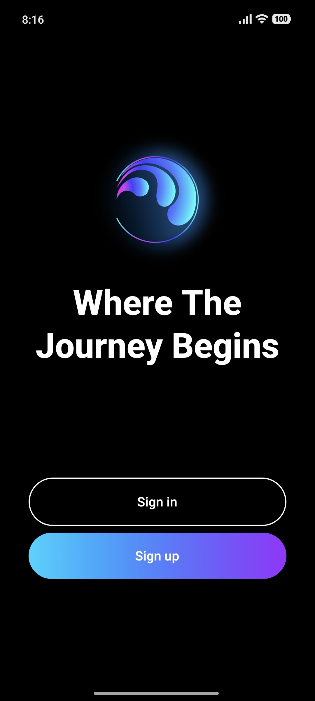
  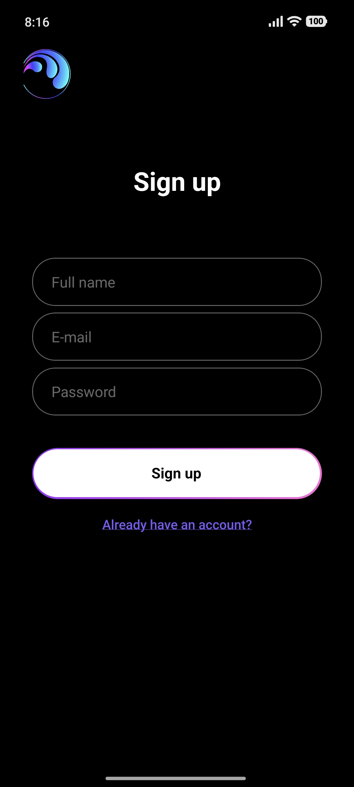
</p>

<p align="center">
  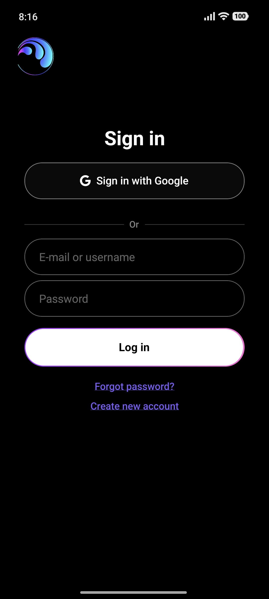
  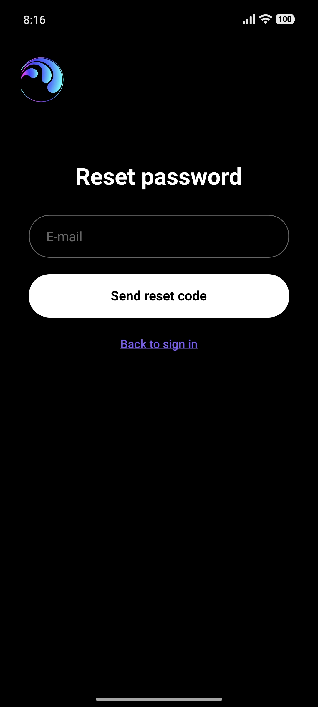
</p>

<p align="center">
  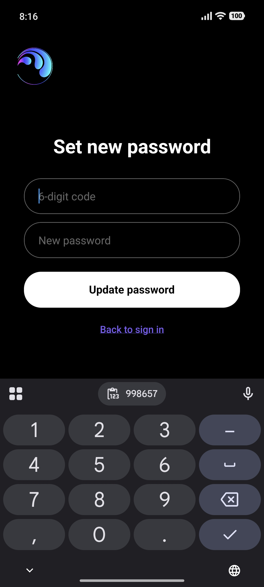
  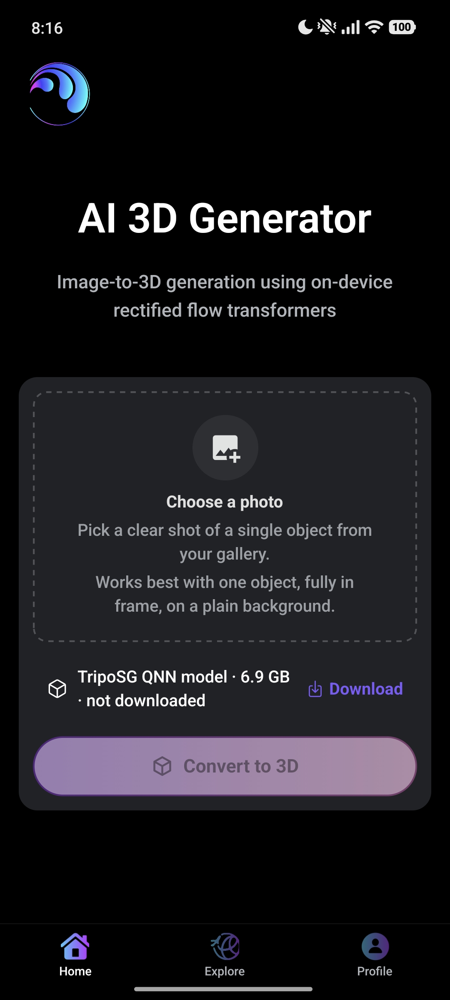
</p>

<p align="center">
  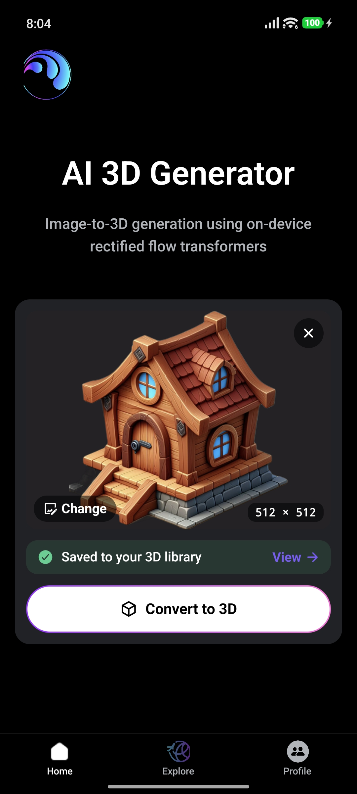
  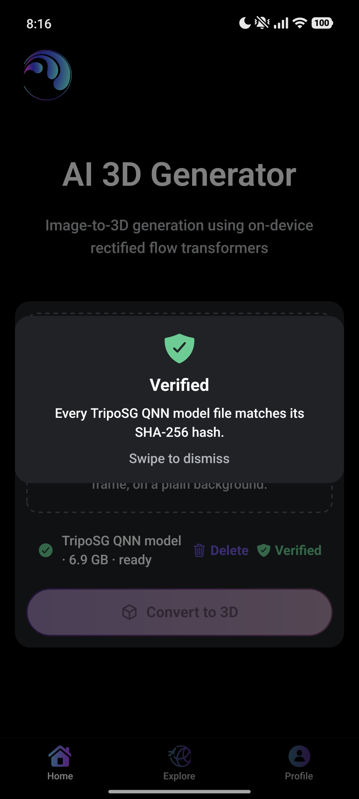
</p>

<p align="center">
  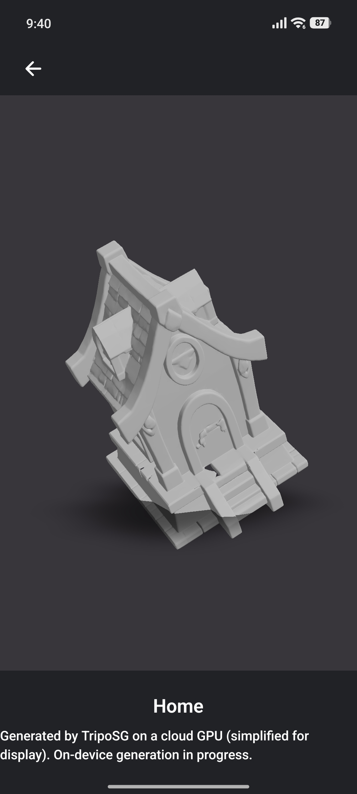
</p>

---

<!-- #region Motivation -->
<details>
  <summary><h1 id="motivation">Motivation</h1></summary>

The open-source image-to-3D [TripoSG](https://github.com/VAST-AI-Research/TripoSG) model is a 1.5B parameter rectified flow transformer trained on 2 million curated 3D shapes from open-source datasets including ShapeNet and Objaverse, as described in the [TripoSG paper](https://arxiv.org/abs/2502.06608).

During training, ground-truth 3D shape representations are encoded into 2048 latent tokens using a Variational Autoencoder (VAE). During inference, the trained model generates shape latents conditioned on an input image, and the VAE decoder reconstructs the 3D mesh from these latents. The paper also describes scaling the architecture to approximately 4B parameters using a Mixture-of-Experts (MoE) configuration and training at a latent resolution of 4096 tokens.

However, the GitHub repository recommends a CUDA-enabled GPU with at least `8GB of VRAM` for inference. This adds a barrier for users who would like to experiment with large AI models and cannot afford a GPU.

</details>
<!-- #endregion -->

---

<!-- #region Updates -->
<details>
  <summary><h1 id="updates">Updates</h1></summary>

Status of the [AI Pipeline Plan](docs/ai_pipeline_plan.md). Full details, sources and logs are in [docs/ai_pipeline.md](docs/ai_pipeline.md).

| Pipeline stage                                         | Status                                                 |
| ------------------------------------------------------ | ------------------------------------------------------ |
| Feasibility audit (Phase 0)                            | Done                                                   |
| Golden reference set and parity harness (Phase 1)      | Done: 5 images, thresholds fixed, all baselines pass   |
| DINOv2 image encoder on the phone                      | Done: runs and matches the GPU output                  |
| Rectified-flow transformer (1.5B) on the phone         | Done (Phase 2): runs on the NPU, ≈5 s per guided step  |
| VAE decoder and mesh extraction on the phone           | Done (Phase 2): NPU decoder + C++ extraction           |
| In-app on-device inference                             | Not started: the app ships an honest demo mode instead |

**Phase 0: feasibility audit.** Every claim about TripoSG was checked against its source code, configs and licenses. The model is a 1.5B-parameter rectified-flow transformer over 2048 latent tokens, conditioned on a DINOv2 image encoder (224×224 input, 257 tokens), followed by an SDF VAE and mesh extraction. In FP32 the transformer weights alone are 5.36 GiB, so a full-precision pipeline cannot fit on a phone: the target is FP16 or INT8 weights, loaded one stage at a time. The background-removal model used by TripoSG, RMBG-1.4, has a non-commercial license, so it is skipped and inputs must be pre-cut images.

**Golden reference set.** [triposg_golden_5.ipynb](ml/triposg-mobile/reference/triposg_golden_5.ipynb) runs the official TripoSG pipeline at FP32 with 50 steps on a Colab T4 GPU, for 5 TripoSG example images cut out with rembg (u2net). It took 413–531 s and about 11 GiB of GPU memory per image. The notebook saves the DINOv2 input and output, the first transformer step's inputs and output, the final latents and the mesh for each image, so every on-device stage can be checked against the GPU result.

**Parity harness (Phase 1).** One command, `python -u ml/triposg-mobile/parity/run_phase1.py`, checks the SHA-256 of every golden file and grades any candidate output against the goldens:

- **Tensors**, for each pipeline stage: max and mean absolute error, relative L2 and cosine similarity.
- **Meshes:** Chamfer distance, F-score at 1% of the bounding-box diagonal, and volume IoU on a 64³ grid.

The acceptance thresholds were fixed before any optimization and are justified in [THRESHOLDS.md](ml/triposg-mobile/parity/THRESHOLDS.md):

| Stage | Pass if |
| --- | --- |
| One transformer step | cosine ≥ 0.999 and relative L2 ≤ 1e-2 |
| Mesh | Chamfer/diagonal ≤ 0.01, F-score ≥ 0.9 and IoU ≥ 0.95 |

They were calibrated on two noise baselines for each of the 5 images, the decimated display mesh against the full mesh, and the same mesh sampled with two seeds. Every baseline passes: Chamfer/diagonal 3.5–4.6e-3, F-score 0.97–1.00, IoU ≥ 0.998.

The eval set stays at 5 images. Its size only bounds how confident the parity check is, not on-device speed or quality.

**On-device DINOv2 encoder.** The encoder runs on a Xiaomi 15 Ultra (Snapdragon 8 Elite, 16 GB RAM, Android 16) as an FP32 ONNX model on the onnxruntime 1.22.0 CPU backend (4 threads), using a small NDK benchmark program run over adb:

| Metric                            | Result                                       |
| --------------------------------- | -------------------------------------------- |
| Latency (5 runs after 2 warm-ups) | median 1084 ms, p90 1110 ms                  |
| Peak memory                       | 2.47 GB                                      |
| Match with the cloud GPU output   | cosine 1.0000001, max abs difference 6.0e-05 |
| Thermal status                    | 0 before and after                           |

**Full pipeline on the phone NPU (Phase 2).** TripoSG now runs end to end on the Xiaomi 15 Ultra's Hexagon NPU, from a golden's initial noise and image features to the final mesh. The [evaluation matrix](ml/triposg-mobile/eval/matrix.md) and [summary](ml/triposg-mobile/eval/summary.md) have the details.

- **Export.** The 1.5B transformer is exported block by block on the laptop (23 batch-1 ONNX units under an 8 GiB memory cap). Qualcomm AI Hub compiles each unit offline for the Snapdragon 8 Elite, because compiling on the phone ran out of memory. Every layer runs on the NPU. The models total 5.6 GB.
- **Decoding.** The VAE decoder is split in two NPU parts: a latent pass (0.3 s) and a point query (34 ms per 8,192 points). Octree extraction, marching tetrahedra and the GLB writer are portable C++. From the golden latents they reproduce the golden mesh at the noise floor (F-score 0.999, IoU 0.9985).
- **Result.** The recommended setting is 50 steps, guidance 7.0 and extraction depth 8. It passes the mesh parity gate on all 5 goldens (Chamfer/diagonal ≤ 5.3e-3, F-score ≥ 0.93, IoU ≥ 0.956) in 4.2–7 minutes per mesh, with about 430 MB peak memory. A 25-step "fast" preset takes about 2.5 minutes. It passes on 2 of the 5 goldens; on the other 3 it gives the same object with small shape drift.

**Demo build.** The Android preview build runs fully offline, with no backend:

- **Login:** a "Continue as demo guest" button creates a local session, since the Express and Cognito backend is not deployed.
- **Image to 3D:** "Choose a demo image" cycles through the 5 golden inputs, and Explore and Stage show the matching TripoSG meshes, simplified to about 80k faces. Every demo mesh is labeled "Generated by TripoSG on a cloud GPU (simplified for display). On-device generation in progress."
- **Release-build fixes:** R8 minification is turned off, because it broke the reflection-based `expo-gl` view. Bundled images are copied out of the Android drawable resources before use.

</details>
<!-- #endregion -->

---

<!-- #region To Do -->
<details>
  <summary><h1 id="todo">To Do</h1></summary>

Remaining phases of the [AI Pipeline Plan](docs/ai_pipeline_plan.md) (Phases 0, 1 and 2 are done):

- **Phase 3, native implementation:**
  - Package the pipeline as a local Expo module (shared C++ core, Kotlin bridge, ONNX Runtime with QNN).
  - Add on-device background removal (u2net) and preprocessing.
  - Decimate meshes for display.
  - Add model download and sideloading with checksums.
  - Build the real image-to-3D adapter.
- **Phase 4, integration and polish:** swap the real adapter into the app, licenses, cleanup of the demo build settings, and end-to-end testing in airplane mode.

</details>
<!-- #endregion -->

---

<!-- #region Architecture -->
<details>
  <summary><h1 id="architecture">Architecture</h1></summary>

This project focuses only on the AI inference feature of the Spotnack mobile application. The project is a Yarn 4 (Berry) monorepo located at `src/spotnack-muse/`, with two workspaces:

- `client/`: React Native app built with Expo.
- `server/`: Express.js REST API written as ES modules.

The root `package.json` holds the shared tooling (ESLint, Prettier, Jest, TypeScript, Babel) and the scripts that run both workspaces together, such as `yarn client`, `yarn server`, `yarn dev`, `yarn prod`, `yarn lint`, and `yarn test`. Node and Yarn versions are pinned via `engines` and `packageManager`.

- The frontend follows the best practices outlined in [this open-source course](https://github.com/camponogaraviera/react-native) and uses the [MVVM architectural pattern](https://github.com/camponogaraviera/full-stack-ai-sw-roadmap/blob/main/full_stack/architectural_patterns/mvvm.md) and [Hexagonal architecture](https://github.com/camponogaraviera/full-stack-ai-sw-roadmap/blob/main/full_stack/architectural_patterns/hexagonal.md) (a.k.a. Ports and Adapters).
- The backend is a RESTful API built with `Express.js` and AWS SDK for authentication with [Amazon Cognito](https://github.com/camponogaraviera/aws/blob/main/infrastructure/security_identity/cognito.md).

The Frontend and Backend architectures, including the project's file source tree, are described in more detail at [docs/architecture.md](docs/architecture.md).

</details>
<!-- #endregion -->

---

<!-- #region AI Pipeline -->
<details>
  <summary><h1 id="pipeline">On-Device AI Inference Pipeline</h1></summary>

The on-device AI inference pipeline is described in more detail at [docs/ai_pipeline.md](docs/ai_pipeline.md).

The original TripoSG AI model architecture:

<p align="center">
  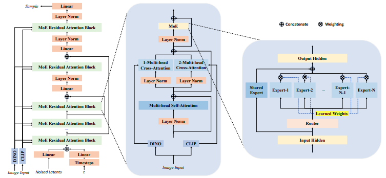
</p>

The proposed on-device AI inference pipeline:

<p align="center">
  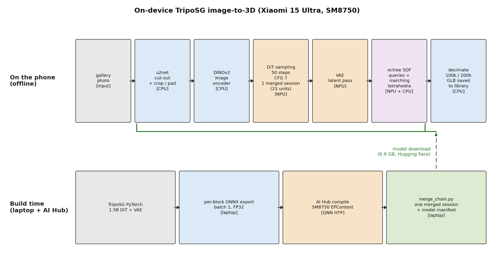
</p>

</details>
<!-- #endregion -->

---

<!-- #region Install Dependencies -->
<details>
  <summary><h1 id="dependencies">Install Dependencies</h1></summary>

1. Install JS dependencies:

```bash
cd src/spotnack-muse/ && yarn
```

2. Install Python dependencies:

```bash
conda env create -f environment.yml && conda activate spotnack-muse
```

</details>
<!-- #endregion -->

---

<!-- #region Run App -->
<details>
  <summary><h1 id="run">Run the Mobile App</h1></summary>
  
- Run Client in development mode:

```bash
yarn client
```

- Run Server in development mode:

```bash
yarn server
```

- Run Client and Server concurrently in development mode:

```bash
NODE_ENV=development yarn dev
```

- Run Client and Server concurrently in production mode:

```bash
NODE_ENV=production yarn prod
```

- Build production mobile binaries with EAS:

```bash
yarn build:production
```

</details>
<!-- #endregion -->

---

<!-- #region Contribution Guidelines -->
<details>
  <summary><h1 id="contribution">Contribution Guidelines</h1></summary>

1. Lint and format your code before opening a pull request:

```bash
pre-commit run --all-files
```

Or manually:

```bash
yarn lint
```

```bash
black .
```

```bash
flake8 .
```

2. Make sure that all unit and property-based tests are passing.

```bash
yarn test
```

</details>
<!-- #endregion -->

---

<!-- #region References -->
<details>
  <summary><h1 id="references"> References </h1></summary>

[1] https://arxiv.org/pdf/2502.06608

[2] https://github.com/VAST-AI-Research/TripoSG

</details>
<!-- #endregion -->
