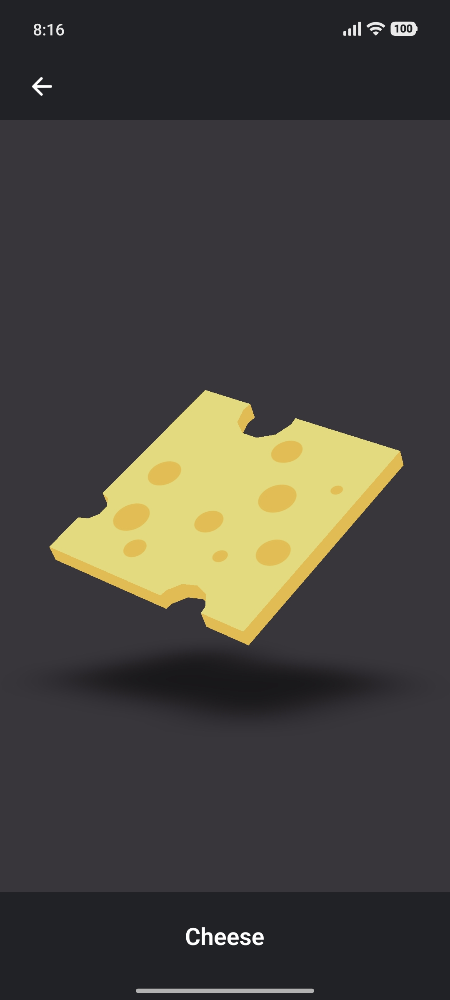

<!-- Badges -->

[](https://sonarcloud.io/summary/new_code?id=spotnack_meta-ai-hackathon)

<!-- Sonar Badges -->

[](https://sonarcloud.io/summary/new_code?id=spotnack_meta-ai-hackathon)

[](https://sonarcloud.io/summary/new_code?id=spotnack_meta-ai-hackathon)
[](https://sonarcloud.io/summary/new_code?id=spotnack_meta-ai-hackathon)
[](https://sonarcloud.io/summary/new_code?id=spotnack_meta-ai-hackathon)

[](https://sonarcloud.io/summary/new_code?id=spotnack_meta-ai-hackathon)
[](https://sonarcloud.io/summary/new_code?id=spotnack_meta-ai-hackathon)
[](https://sonarcloud.io/summary/new_code?id=spotnack_meta-ai-hackathon)
[](https://sonarcloud.io/summary/new_code?id=spotnack_meta-ai-hackathon)
[](https://sonarcloud.io/summary/new_code?id=spotnack_meta-ai-hackathon)

[-v26.13.0-informational>)](https://nodejs.org/en)
[](https://yarnpkg.com/)
[](https://reactnative.dev/)
[-58.0.22-informational>)](https://docs.expo.dev/)
[-58.1.18-informational>)](https://docs.expo.dev/)

[](https://www.python.org/downloads/)
[](https://pytorch.org/)

[](https://github.com/spotnack/meta-ai-hackathon/graphs/commit-activity)

<!-- Dependencies -->

<a href="https://www.python.org/" target="_blank" rel="noopener noreferrer"></a>
<a href="https://developer.mozilla.org/en-US/docs/Web/JavaScript" target="_blank" rel="noopener noreferrer"></a>
&nbsp;
&nbsp;
<a href="https://react.dev/" target="_blank" rel="noopener noreferrer"></a>
&nbsp;
&nbsp;
<a href="https://threejs.org/" target="_blank" rel="noopener noreferrer"></a>
&nbsp;
&nbsp;
<a href="https://nodejs.org/en" target="_blank" rel="noopener noreferrer"></a>
&nbsp;
&nbsp;
<a href="https://pytorch.org/" target="_blank" rel="noopener noreferrer"></a>
&nbsp;
&nbsp;
<a href="https://aws.amazon.com/" target="_blank" rel="noopener noreferrer"></a>
<br>
<br>

<!-- Logo: -->
<div align="center">
  <a href="https://www.instagram.com/spotnack/#">
    
  </a>
</div>

<!-- Title: -->
<div align='center'>
  <h1> Meta Global AI Developer Hackathon </h1>
  <h2> On-Device AI Inference Pipeline for Image-to-3D Rectified-Flow Transformers Models </h2>
</div>

<!-- Demo: -->
<div align='center'>
  <h2><a href="https://youtube.com/shorts/l_34ArLKoug"> Watch the Pre Demo Video </a></h2>
  <h2><a href="https://expo.dev/accounts/camponogaralucas/projects/client/builds/e4430639-226a-41cd-aa83-c89dd6050923"> Try the Development Build on Your own Device </a></h2>
</div>

# About

This repository presents a mobile application with an on-device AI inference pipeline for 3D shape synthesis using an image-to-3D [Rectified-Flow Transformer](https://arxiv.org/pdf/2403.03206) model optimized to run in mobile applications.

The solution for the AI pipeline was developed during the [Meta Global AI Developer Hackathon](https://cerebralvalley.ai/e/meta-ai-developer-hackathon) using [Muse AI](https://dev.meta.ai/docs/muse-code).

- First commit (init): No AI agent was used.
- Second commit: Uses Meta's Muse AI.

---

# Motivation

The open-source image-to-3D [TripoSG](https://github.com/VAST-AI-Research/TripoSG) model is a 1.5B parameter rectified flow transformer trained on 2 million curated 3D shapes from open-source datasets including ShapeNet and Objaverse, as described in the [TripoSG paper](https://arxiv.org/abs/2502.06608).

During training, ground-truth 3D shape representations are encoded into 2048 latent tokens using a Variational Autoencoder (VAE). During inference, the trained model generates shape latents conditioned on an input image, and the VAE decoder reconstructs the 3D mesh from these latents. The paper also describes scaling the architecture to approximately 4B parameters using a Mixture-of-Experts (MoE) configuration and training at a latent resolution of 4096 tokens.

However, the GitHub repository recommends a CUDA-enabled GPU with at least `8GB of VRAM` for inference. This adds a barrier for developers who would like to experiment with large AI models and cannot afford a GPU.

<p align="center">
  
  
</p>

<p align="center">
  
  
</p>

<p align="center">
  
  
</p>

<p align="center">
  
  
</p>

<p align="center">
  
  
</p>

---

<!-- #region Architecture -->
<details>
  <summary><h1 id="architecture">Architecture</h1></summary>

This current application is a small portion of the Spotnack mobile app that focuses only on the AI inference. The project is a Yarn 4 (Berry) monorepo located at `src/spotnack-muse/`, with two workspaces:

- `client/`: React Native app built with Expo.
- `server/`: Express.js REST API written as ES modules.

The root `package.json` holds the shared tooling (ESLint, Prettier, Jest, TypeScript, Babel) and the scripts that run both workspaces together, such as `yarn client`, `yarn server`, `yarn dev`, `yarn prod`, `yarn lint`, and `yarn test`. Node and Yarn versions are pinned via `engines` and `packageManager`.

- The frontend follows the best practices outlined in [this open-source course](https://github.com/camponogaraviera/react-native) and uses the [MVVM architectural pattern](https://github.com/camponogaraviera/full-stack-ai-sw-roadmap/blob/main/full_stack/architectural_patterns/mvvm.md) and [Hexagonal architecture](https://github.com/camponogaraviera/full-stack-ai-sw-roadmap/blob/main/full_stack/architectural_patterns/hexagonal.md) (a.k.a. Ports and Adapters).
- The backend is a RESTful API built with `Express.js` and AWS SDK for authentication with [Amazon Cognito](https://github.com/camponogaraviera/aws/blob/main/infrastructure/security_identity/cognito.md).

The Frontend and Backend architectures, including the project's file source tree, are described in more detail at [docs/architecture.md](docs/architecture.md).

</details>
<!-- #endregion -->

---

<!-- #region AI Pipeline -->
<details>
  <summary><h1 id="pipeline">On-Device AI Inference Pipeline</h1></summary>

The on-device AI inference pipeline is described in more detail at [docs/pipeline.md](docs/ai_pipeline.md).

The original TripoSG AI model architecture:

<p align="center">
  
</p>

The proposed on-device AI inference pipeline:

<p align="center">
  
</p>

</details>
<!-- #endregion -->

---

<!-- #region Install Dependencies -->
<details>
  <summary><h1 id="dependencies">Install Dependencies</h1></summary>

1. Install JS dependencies:

```bash
cd src/spotnack-muse/ && yarn
```

2. Install linting dependencies:

```bash
conda env create -f environment.yml && conda activate spotnack-muse
```

</details>
<!-- #endregion -->

---

<!-- #region Run App -->
<details>
  <summary><h1 id="run">Run the Mobile App</h1></summary>
  
- Run Client in development mode:

```bash
yarn client
```

- Run Server in development mode:

```bash
yarn server
```

- Run Client and Server concurrently in development mode:

```bash
NODE_ENV=development yarn dev
```

- Run Client and Server concurrently in production mode:

```bash
NODE_ENV=production yarn prod
```

- Build production mobile binaries with EAS:

```bash
yarn build:production
```

</details>
<!-- #endregion -->

---

<!-- #region Contribution Guidelines -->
<details>
  <summary><h1 id="contribution">Contribution Guidelines</h1></summary>

1. Lint and format your code before opening a pull request:

```bash
pre-commit run --all-files
```

Or manually:

```bash
yarn lint
```

```bash
black .
```

```bash
flake8 .
```

2. Make sure that all unit and property-based tests are passing.

```bash
yarn test
```

</details>
<!-- #endregion -->

---

<!-- #region References -->
<details>
  <summary><h1 id="references"> References </h1></summary>

[1] https://arxiv.org/pdf/2502.06608

[2] https://github.com/VAST-AI-Research/TripoSG

</details>
<!-- #endregion -->
